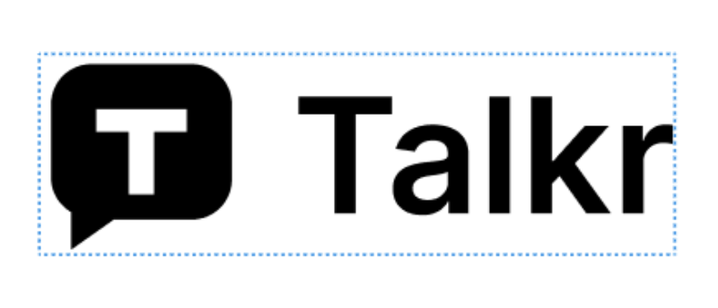
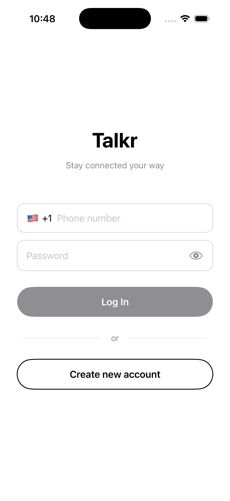
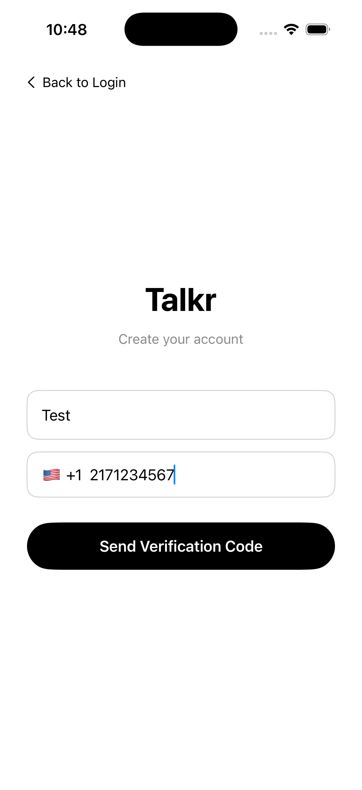
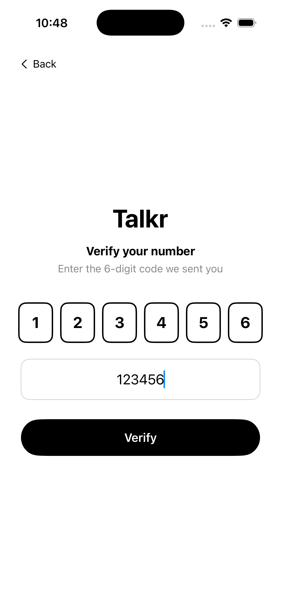
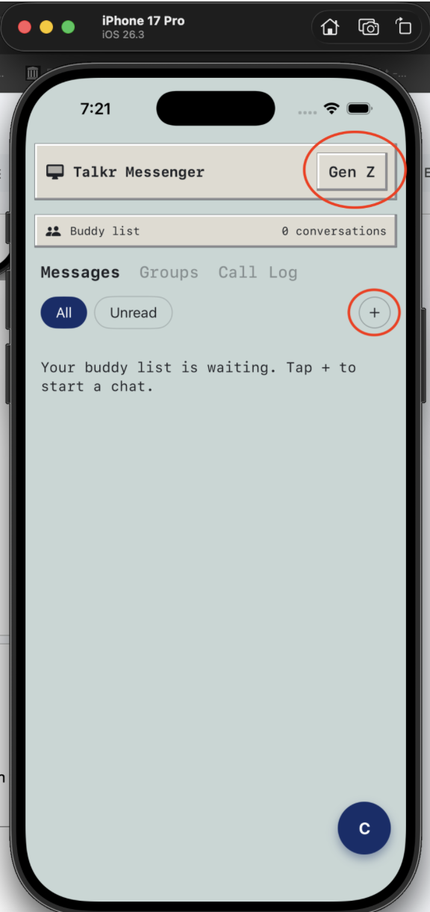
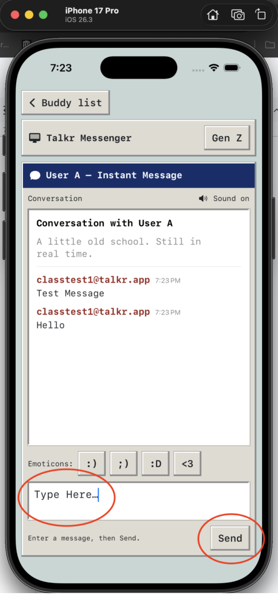
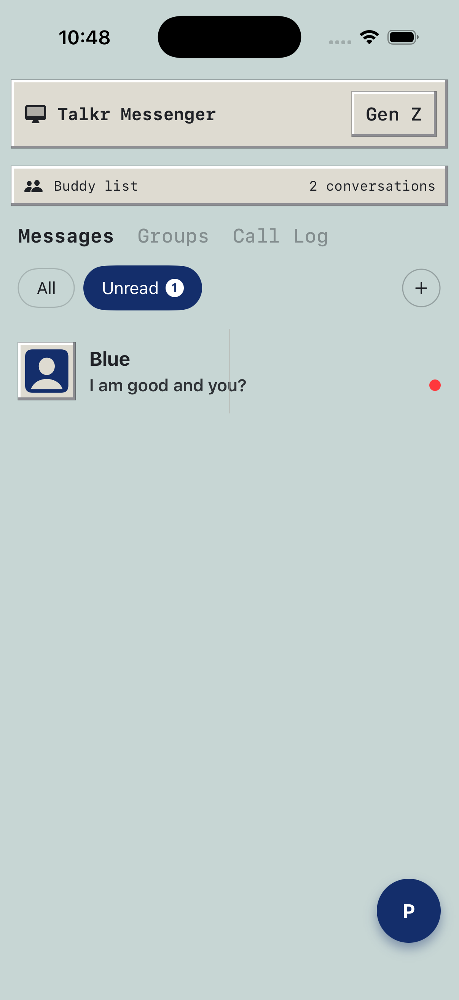
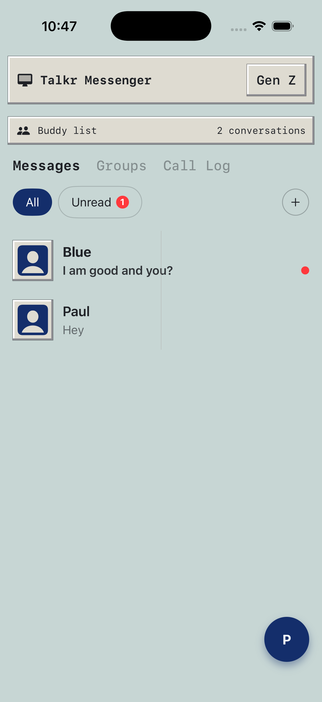
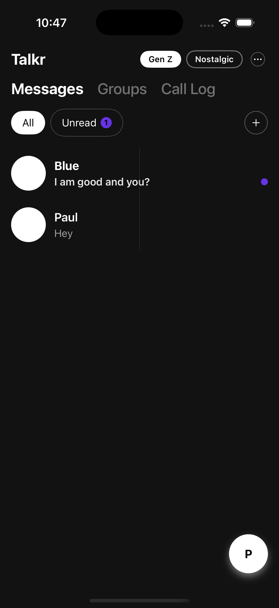
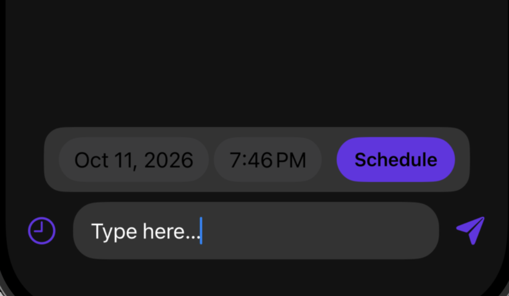

# Talkr – User Manual

**Version:** 1.0
**Team Number / Name:** Team 4 (Group 7)
**Company:** Insple LLC
**Team Members:** Haider Beg, Jonathan Gilreath, Tyler Snow, Binod Chhantyal, Grayson Turner
**Date:** 10/09/2026

---

## 1. Introduction

Talkr is an iPhone and iPad messaging app that lets you change how your conversations look and feel. Switch between **Nostalgic Mode** (a classic 90s/early-2000s chat style) and **Gen Z Mode** (a bright, modern style) any time you like. You can send text, photos, and videos, and you can schedule a message to be delivered automatically at a future date and time.

---

## 2. System Requirements

- **Device (Hardware):** iPhone or iPad. Talkr is **iOS only**. It is not available for Android, Windows, or Mac.
- **Operating System (Software):** iOS 18.7.5 or newer (iOS 26.3 recommended). Older iPhones such as the iPhone XS work if they are updated to iOS 18.7.5.
- **Internet:** An active Wi-Fi or cellular connection is required to send and receive messages.
- **Phone Number:** A **US phone number** that can receive text messages. You use it to create your account and log in.
- **Device features Talkr may ask permission to use:**
  - Notifications (new message alerts)
- **Other Dependencies:** A Talkr account (created inside the app). No extra software or API keys are needed.

---

## 3. Installation Guide

1. On your iPhone or iPad, open **the App Store**.
2. [Tap this link to open Talkr:link coming soon..] or search for **"Talkr"**.
3. Tap **Get**.
4. Wait for the download to finish. The Talkr icon will appear on your Home Screen.
5. Tap the **Talkr** icon to open the app.

> **Tip:** If the app will not install, check that your device is running iOS 18.7.5 or newer (**Settings → General → Software Update**).

---

## 4. Getting Started

### 4.1 Launch the app
Tap the **Talkr** icon on your Home Screen.

### 4.2 Create your account or log in
Talkr uses your **US phone number** to sign you in. There is no separate email or password to remember.

1. On the welcome screen, tap **[FILL IN: Continue / Sign Up]**.
2. Enter your 10-digit US phone number.
3. Tap **[Send Verification Code]**.
4. Enter the code you receive.
5. If you are new, set up your profile (username and photo). If you already have an account, you will go straight to your chats.

> Each account is tied to a single phone number.

### 4.3 Toggle your theme
Pick **Nostalgic** or **Gen Z**. You can change it any time.

### 4.4 Send your first message
1. Tap **+ button**.
2. Choose a person to chat with.
3. Type a message and tap **Send**.

### 4.5 Log out
Go to **[Profile Tab → Log Out]**. To log back in, repeat step 4.2 with the same phone number.

---

## 5. Features & Functions

### Feature 1: Account & Profile

**What it does:** Lets you create an account with your phone number, log in securely, and manage your profile (username, photo, and details).

**How to use it:**
1. Tap **[Profile tab]**.
2. Change your username, photo, or other details.
3. Tap **Save**.

---

### Feature 2: Real-Time Messaging

**What it does:** Send and receive text messages almost instantly. You can see when a message is **delivered** and **read**.You get an in-app notification when a new message arrives.

**How to use it:**
1. Open a conversation (or start a new one).
2. Tap the message box and type your text.
3. Tap **Send**. A status indicator shows when the message is delivered and read.

> Messages that are empty or contain only spaces cannot be sent. If sending fails, Talkr shows an error so you can try again.

---

### Feature 3: Mode & Theme Switching (Nostalgic / Gen Z)

**What it does:** Changes the look, feel, and tone of your whole app. Talkr remembers your choice and restores it when you log in again.

| Mode | What you get |
|---|---|
| **Nostalgic Mode** | Classic 90s/early-2000s messaging look and chat flow |
| **Gen Z Mode** | Modern, vibrant look|

**How to use it:**
1. Tap **Theme icon**.
2. Choose **Nostalgic** or **Gen Z**.
3. The new theme applies to every screen right away.

---

### Feature 4: Message Scheduling

**What it does:** Write a message now and have Talkr send it automatically at a future date and time, even if you are not in the app. Delivery happens within about 30 seconds of the time you choose. Scheduled messages are marked with a scheduled-send indicator in the conversation.

**How to schedule a message:**
1. Open a conversation and type your message.
2. Tap the **Schedule** icon (in the message bar) instead of **Send**.
3. Pick a **future** date and time in the picker. Past times are not accepted.
4. Confirm. 

---

### Coming Soon

These features are planned for a future version and are **not available yet**: media(photos and videos) sharing, video calls, voice calls, group chats, and muting conversations.

---

## 6. Troubleshooting

| Problem | Likely Cause | Solution |
|---|---|---|
| App won't install | iOS is too old or storage is full | Update to iOS 18.7.5 or newer in **Settings → General → Software Update**, and free up storage. |
| Verification code never arrives | Wrong phone number, poor cell signal, or non-US number | Check that you entered your 10-digit US number correctly, confirm you have signal, then tap **[Resend Code]**. |
| Code is rejected | Typo or expired code | Re-enter carefully, or request a new code and use the newest one. |
| Messages won't send | No internet connection | Check Wi-Fi/cellular. Offline messages send automatically once you reconnect. |
| Send button inactive | Message is empty or only spaces | Type some text, then tap Send. |
| No notification alerts | Notifications are turned off for Talkr | Turn on **Settings → Notifications → Talkr** in iOS. |
| Can't schedule a message | Chosen time is in the past | Pick a date and time in the future. |
| Scheduled message didn't send | Service or network issue at send time | Check for an error notification, then re-send it manually. |

---

## 7. Contact Information

- **Support Email:** coming soon..
- **Website:** "Not applicable"
- **Project Repository:** [https://github.com/haideralibeg/Insple-messaging-app]

---

## 8. FAQ & Pro-Tips (Extra Credit)

**Q: Is Talkr available on Android or desktop?**
**A:** Not yet. The current release is for iPhone and iPad only.

**Q: Do I need a US phone number?**
**A:** Yes. Talkr currently signs you in with a US phone number, and each account is tied to one number.

**Q: Are my messages private?**
**A:** Yes. Private conversations use end-to-end encryption, and you control who can contact you and what others see.

**Q: Can I make voice calls, create group chats, or mute conversations?**
**A:** Not yet. These are planned for a future update.

**Q: Can I unsend a message?**
**A:** Not in this version. For timing control, use **Message Scheduling** and cancel before the send time.

**Q: Can I log in with Face ID or a fingerprint?**
**A:** Not in this version. Log in with your phone number and verification code.

**Pro-Tip:** Switch to Nostalgic Mode for a calmer chat, or Gen Z Mode when you want modern feel.

**Pro-Tip:** Use Schedule for birthday wishes or reminders you want to arrive at exactly the right moment.

